<div align="center">


# Marching Band Attendance

**Tap in with GPS or QR — attendance, streaks and reports handled automatically.**

English · [ภาษาไทย](README.th.md)


[Features](#features) · [Architecture](#architecture) · [Flows](#system-flows) · [Data model](#data-model) · [Setup](#setup-guide) · [Deploy](#deploy)

</div>

A mobile-first web app (installable PWA) that lets marching band students check in to rehearsals with **GPS** or a **QR code**, and gives teachers and admins live attendance, reports and schedule management.

| Check in | Automation | Insight |
|---|---|---|
| GPS radius check or teacher-shown QR code, both validated against the rehearsal time window | Sessions generated nightly, absentees marked automatically, holidays respected | Live roster, streaks and badges, per-student calendar, Thai PDF reports |

| Layer | Stack |
|---|---|
| **Frontend** | React 18 · TypeScript · Vite · Tailwind CSS + shadcn/ui (Radix) · Zustand · TanStack Query · Recharts · `@react-pdf/renderer` · `html5-qrcode` · `qrcode.react` |
| **Backend** | Supabase — PostgreSQL · Auth · Realtime · Storage · Row Level Security · `pg_cron` |
| **Hosting** | Netlify (static SPA) |

---

## Table of contents

1. [Features](#features)
2. [Architecture](#architecture)
3. [Roles and permissions](#roles-and-permissions)
4. [Attendance rules](#attendance-rules)
5. [System flows](#system-flows)
   - [Authentication and session restore](#1-authentication-and-session-restore)
   - [Daily session generation](#2-daily-session-generation-automatic)
   - [GPS check-in](#3-gps-check-in-student)
   - [QR check-in](#4-qr-check-in-student)
   - [Absence reason (excused)](#5-absence-reason-excused)
   - [Automatic absent marking](#6-automatic-absent-marking)
   - [Teacher override](#7-teacher-override)
   - [Streaks and badges](#8-streaks-and-badges)
   - [Thursday afternoon ร.ด. exemption](#9-thursday-afternoon-รด-exemption)
   - [Schedule, holidays and extra sessions](#10-schedule-holidays-and-extra-sessions)
   - [Semester management](#11-semester-management-admin)
   - [Reports and PDF export](#12-reports-and-pdf-export)
6. [Data model](#data-model)
7. [Project structure](#project-structure)
8. [Setup guide](#setup-guide)
9. [Deploy](#deploy)

---

## Features

**Students**
- Check in with GPS (must be inside the configured radius of the music room)
- Check in by scanning the QR code the teacher displays (GPS is verified as well)
- Submit a reason when unable to attend (status becomes *excused*)
- Attendance history and personal calendar
- Streak counter and badges for consecutive attendance
- Profile picture upload, change / reset password

**Teachers**
- Live attendance per session (Supabase Realtime)
- Override any student's status with a note
- Show a per-session QR code for check-in
- Add extra rehearsal sessions, manage holidays and term breaks
- Manage the student list and promote the academic year (year level + 1, M.6 → graduated)
- Reports for every section, per-student calendar, PDF export

**Admins** (everything teachers can do, plus)
- Create user accounts (student / teacher / admin), change roles, enable / disable accounts
- Manage academic terms (semester 1 / 2)
- Manage sections and instruments
- Configure the GPS location and allowed radius

**Automation**
- Rehearsal sessions are generated every night by `pg_cron`
- Students who never check in are marked *absent* automatically after the window closes
- Streaks and badges are recalculated by a database trigger on every attendance change

---

## Architecture

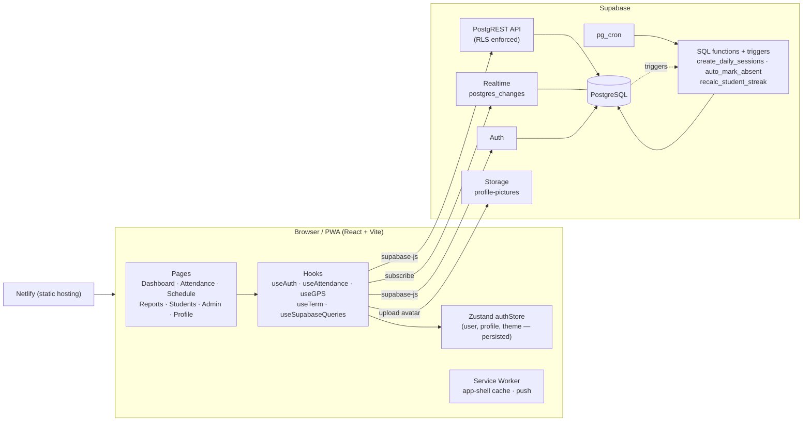

The browser talks to Supabase directly with the public anon key. **All authorization is enforced by Row Level Security policies in the database**, not by the frontend. Route guards in the React app (`ProtectedRoute`, `AdminRoute`) are only for UX.

---

## Roles and permissions

| Capability | Student | Teacher | Admin |
|---|:--:|:--:|:--:|
| Check in (GPS / QR) for self | Yes | Yes | Yes |
| Read own attendance, streak, badges | Yes | Yes | Yes |
| Read everyone's attendance | No | Yes | Yes |
| Override / insert attendance for others | No | Yes | Yes |
| Display session QR code | No | Yes | Yes |
| Manage sessions, holidays, term breaks | No | Yes | Yes |
| Students / reports pages | No | Yes | Yes |
| Create accounts, change roles, disable accounts | No | No | Yes |
| Manage terms, sections, GPS settings (Admin page) | No | partly¹ | Yes |

¹ Teachers can update the GPS settings row; inserting / deleting it is admin only.

Frontend routes:

| Route | Access |
|---|---|
| `/login`, `/forgot-password`, `/reset-password`, `/qr/:token` | public (the QR page itself asks the user to sign in) |
| `/dashboard`, `/attendance`, `/schedule`, `/reports`, `/profile` | any signed-in user |
| `/students`, `/admin` | teacher or admin (`AdminRoute`) |

---

## Attendance rules

All times are **Asia/Bangkok**. The rules live in one place on the client (`ATTENDANCE_RULES` in [`src/lib/utils.ts`](src/lib/utils.ts)) and are mirrored by the SQL functions.

| Session | Days | Check-in opens | Present until | Late until | Absent after |
|---|---|---|---|---|---|
| **Morning** (`morning`) | Mon–Fri | 05:00 | 07:45 | 08:30 | 08:30 |
| **Club period** (`club`) | Thu | 15:20 | 15:45 | 16:00 | 16:00 |
| **Extra** (`extra`) | any | session start | — (always *present*) | — | session end |

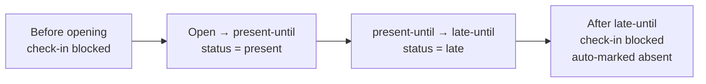

Possible statuses: `present`, `late`, `absent`, `excused`.

> [!NOTE]
> `present` and `late` both count as attending. `absent` and `excused` break a streak.

---

## System flows

### 1. Authentication and session restore

[`src/App.tsx`](src/App.tsx) owns the auth lifecycle. It is written to survive slow mobile networks without bouncing the user to the login page.

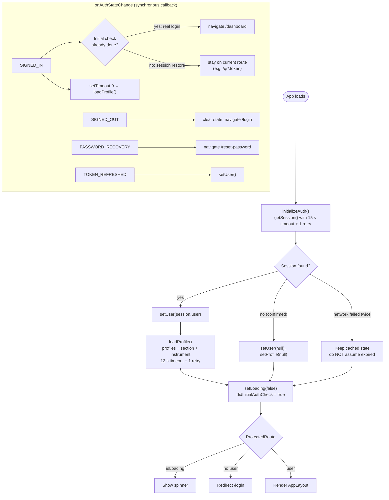

Two details worth knowing:

- The `onAuthStateChange` callback never `await`s a Supabase call. supabase-js holds a navigator lock while the callback runs, so awaiting inside would deadlock. DB work is deferred with `setTimeout(0)`.
- `SIGNED_IN` also fires when a session is merely restored. The app only redirects to `/dashboard` for a real login, otherwise scanning a QR code would be redirected away from `/qr/:token`.

New accounts are created with `supabase.auth.signUp`. A database trigger (`handle_new_user`) inserts the matching `profiles` row (role defaults to `student`); the admin form then updates the remaining profile fields.

---

### 2. Daily session generation (automatic)

Students check in against a **row in `practice_sessions`**, so the row has to exist first. `pg_cron` creates tomorrow's sessions every night.

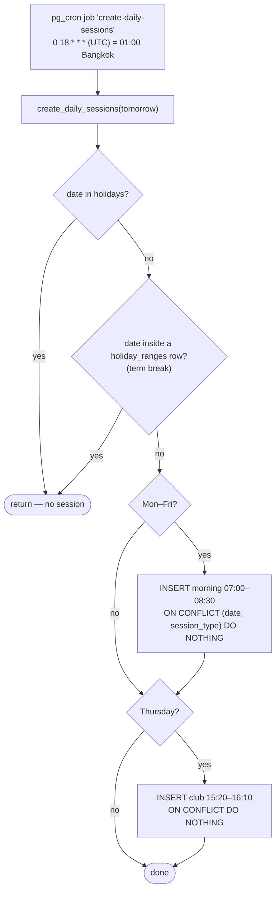

- Each session gets a random `qr_token` (16 random bytes, hex) at insert time.
- The `UNIQUE(date, session_type)` constraint makes the job idempotent, so it is safe to run it again or to backfill past dates.
- `SchedulePage` also upserts tomorrow's sessions on load as a safety net if the cron job missed a day.
- Adding a holiday deletes that day's non-override sessions; teacher-created sessions have `is_override = true` and are kept.

---

### 3. GPS check-in (student)

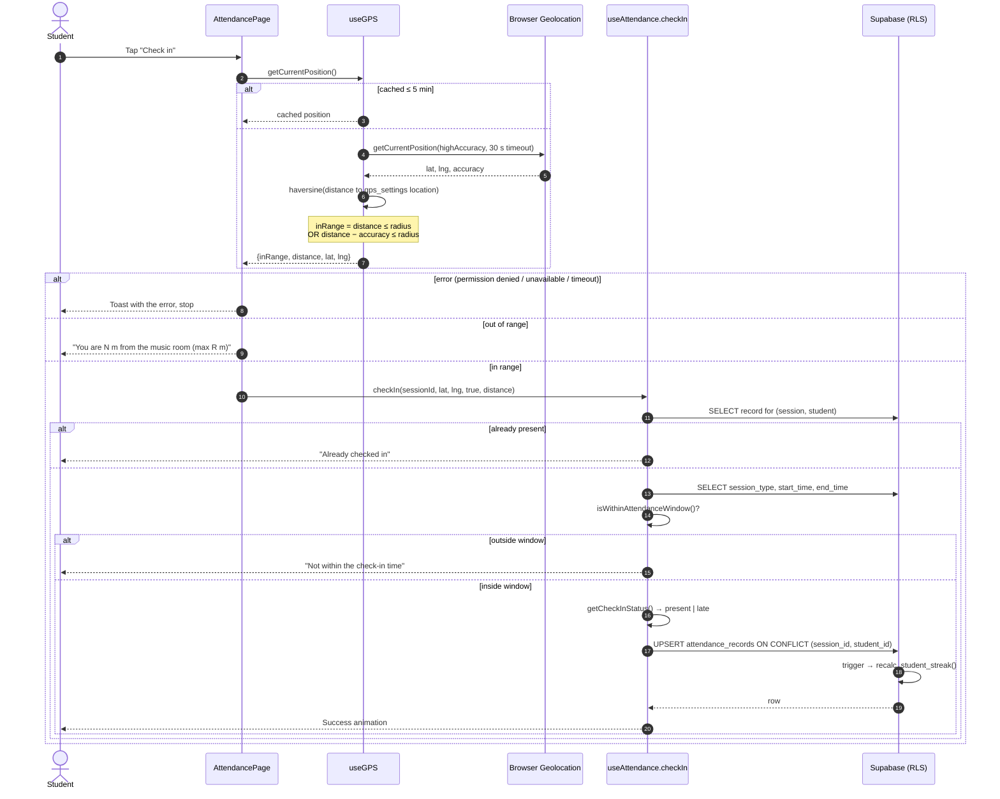

Notes:

- The location and radius come from the `gps_settings` table (admin editable). If it cannot be loaded, the app falls back to a built-in default.
- The accuracy tolerance avoids rejecting students standing at the edge of the radius on a poor GPS fix.
- The window and status are computed on the **client clock converted to Bangkok time**. The database policy only verifies that `student_id = auth.uid()`; it does not re-validate the time. Treat the GPS/QR checks as a deterrent for honest use, not as tamper-proof.

---

### 4. QR check-in (student)

The teacher opens **QR Code** on a session card in `/attendance`. The dialog renders `https://<host>/qr/<qr_token>`. A student scans it with the phone camera, which opens the page in the browser.

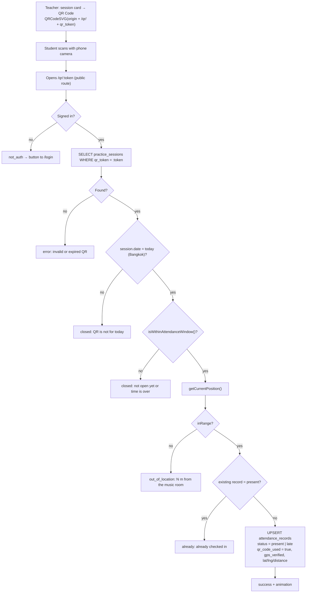

The QR token proves the student is holding the code the teacher showed; the GPS check proves they are physically near the room. Both must pass. A student who is not signed in is shown the login prompt, and after signing in the app does not force-redirect, so the `/qr/:token` page can complete.

---

### 5. Absence reason (excused)

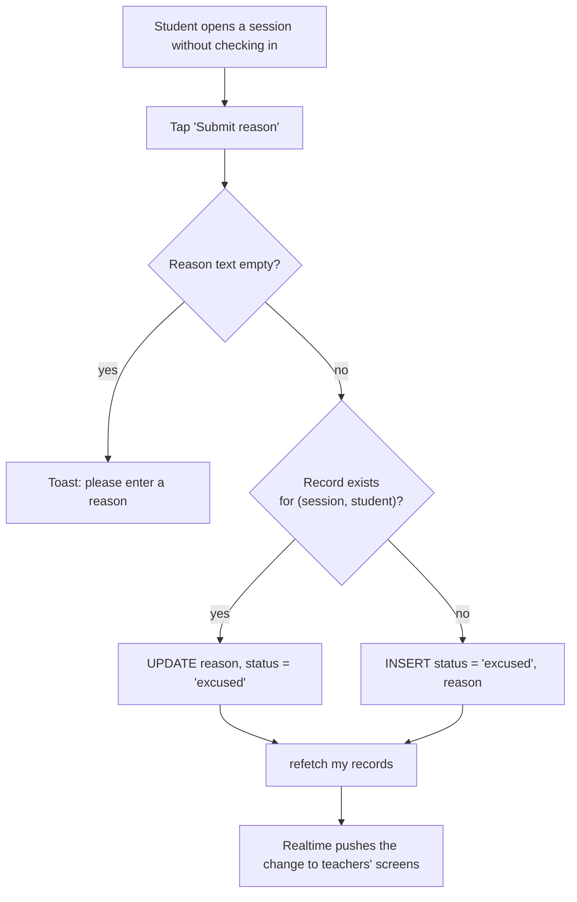

An *excused* record is not overwritten by the automatic absent job because that job only inserts rows for students with no record at all.

---

### 6. Automatic absent marking

Students who never check in must still get an `absent` row so reports and streaks are correct. This runs in **two places** for resilience.

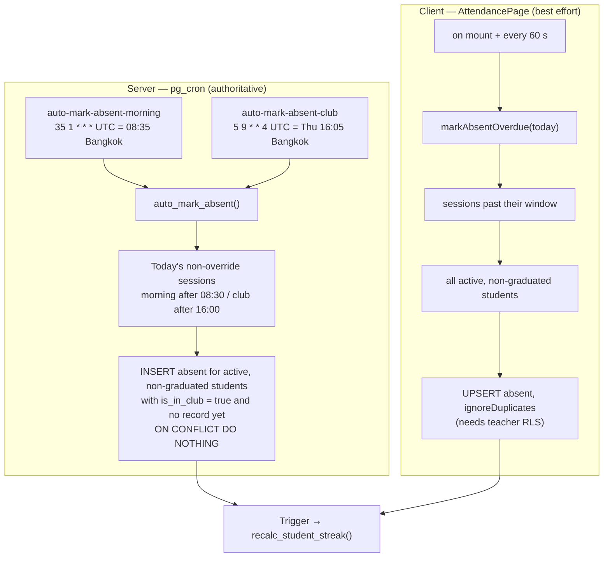

- The cron job is the source of truth. The client sweep gives teachers an up-to-date view right after the window closes.
- Students with `is_in_club = false` are skipped by the SQL job (see the [ร.ด. exemption](#9-thursday-afternoon-รด-exemption)).

---

### 7. Teacher override

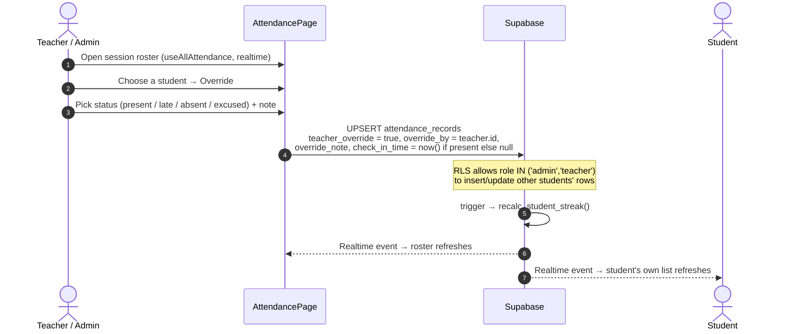

Overridden rows keep `teacher_override`, `override_by` and `override_note` so the change stays auditable.

---

### 8. Streaks and badges

Computed entirely in the database so that every write path (GPS, QR, override, cron) stays consistent.

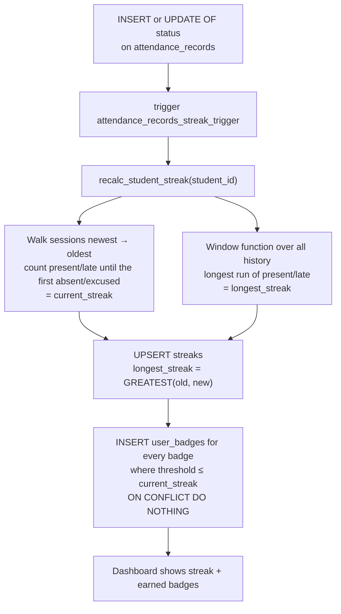

- Streaks count **real sessions** in order, so weekends and holidays (which have no session) are skipped automatically.
- Seeded badges: `streak_3`, `streak_5`, `streak_10`, `streak_20`. The `badges` table is the catalogue; add rows to add badges without a deploy.
- Deleting a session sets `streaks.last_session_id` to `NULL` instead of blocking the delete (migration `023`).

---

### 9. Thursday afternoon ร.ด. exemption

Students with `is_in_club = false` attend ร.ด. (military training) on Thursday afternoons instead of the club period, so that session must not count against them.

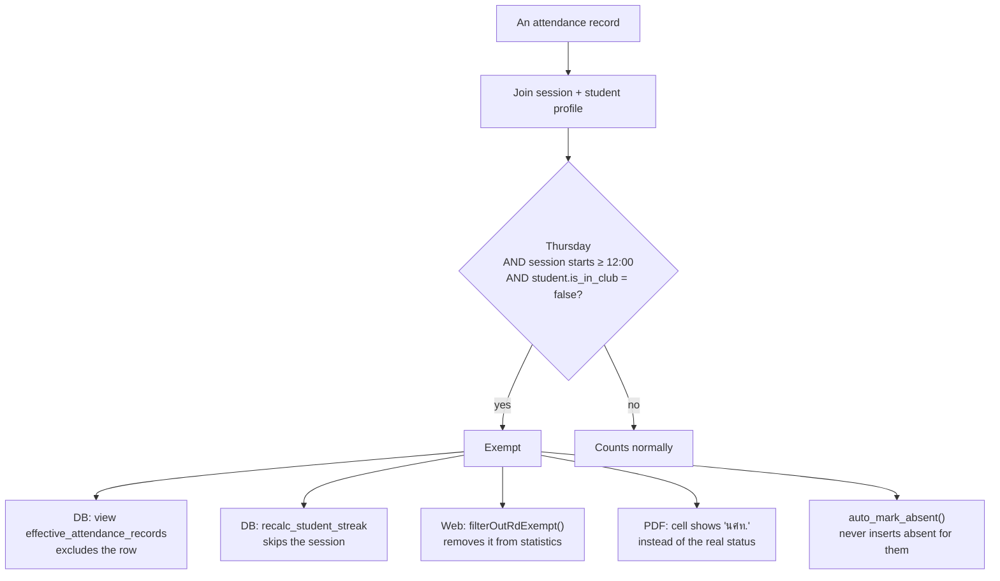

The rule is implemented in [`src/lib/attendanceExemption.ts`](src/lib/attendanceExemption.ts) and mirrored in migration `022`. If a dedicated `session_type` is introduced for this period, set `THURSDAY_AFTERNOON_SESSION_TYPES` (client) and change the view's `WHERE` clause (SQL) so both switch from the time heuristic to the type.

---

### 10. Schedule, holidays and extra sessions

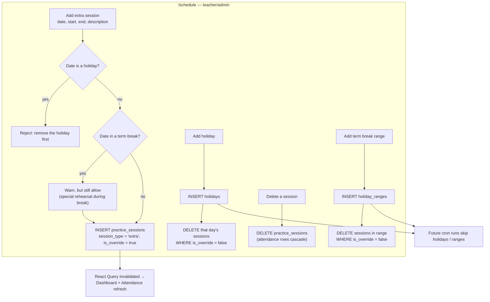

Extra sessions have no fixed time rule: check-in is valid between the stored `start_time` and `end_time`, and any successful check-in counts as `present`.

---

### 11. Semester management and year promotion

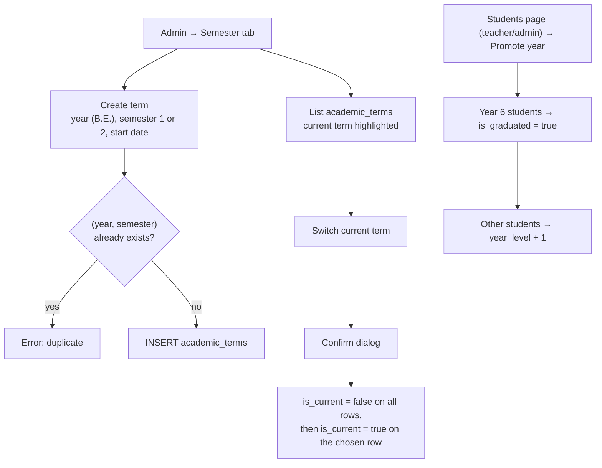

### 12. Reports and PDF export

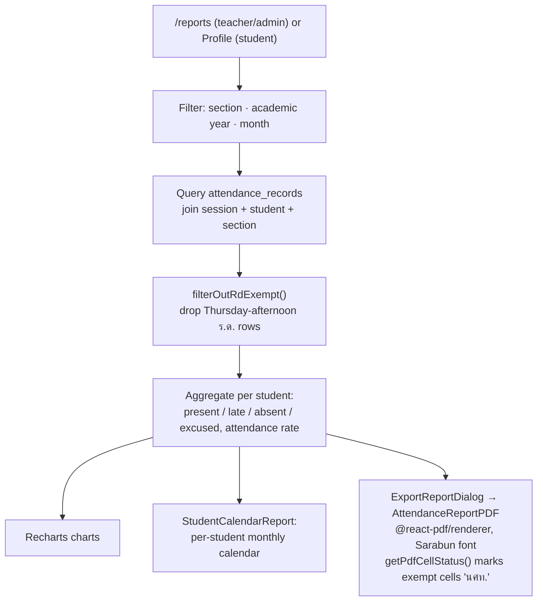

Thai fonts (Sarabun, Pridi) are bundled in `public/fonts/` so the PDF renders Thai without external requests.

---

## Data model

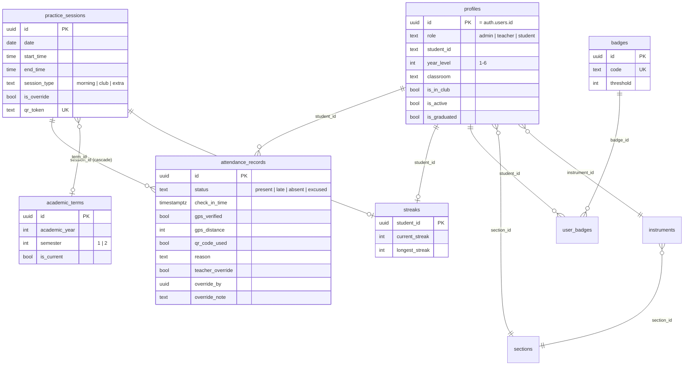

Other tables: `holidays`, `holiday_ranges`, `gps_settings`, `schedule_overrides`, `notifications`. Storage bucket: `profile-pictures` (public read, authenticated write). View: `effective_attendance_records`.

Key constraints: `UNIQUE(date, session_type)` on sessions and `UNIQUE(session_id, student_id)` on attendance records. These make every write an idempotent upsert.

### Migrations

Run the files in [`supabase/migrations/`](supabase/migrations/) **in numeric order**:

| File | Purpose |
|---|---|
| `001_initial` | Core schema, RLS, storage bucket, seed sections/instruments, academic terms |
| `002_hotfix_trigger` | Fix for the new-user trigger |
| `003_fix_rls_recursion` | Remove recursive RLS policies (adds `get_my_role()`) |
| `004_holidays`, `005_holiday_ranges` | Holidays and term-break tables |
| `006_gps_settings`, `007_fix_gps_settings_policies` | Configurable GPS location + policy fix |
| `008_add_classroom` | `profiles.classroom` |
| `009_attendance_rls_policies` | Student / teacher attendance policies |
| `010_create_daily_sessions_fn` | `create_daily_sessions()` |
| `011_schedule_daily_sessions_cron` | Nightly cron + initial backfill |
| `012_daily_sessions_end_0810`, `013_daily_sessions_clean_descriptions` | Session end time / description changes |
| `014_teacher_insert_attendance_policy` | Teachers can insert attendance for others |
| `015_fix_cron_date_cast` | Cron date-cast fix |
| `016_backfill_sessions_jun_jul` | One-off backfill |
| `017_set_morning_end_0830`, `018_daily_sessions_end_0830` | Morning end time set to 08:30 (existing rows + function) |
| `019_add_indexes` | Performance indexes |
| `020_auto_mark_absent` | `auto_mark_absent()` + two cron jobs |
| `021_streaks_badges` | Streak/badge tables, function, trigger, RLS |
| `022_thursday_rd_exemption` | `effective_attendance_records` view + streak update |
| `023_fix_streak_session_fk` | `ON DELETE SET NULL` for `streaks.last_session_id` |

> [!IMPORTANT]
> Several of these redefine `create_daily_sessions()`; the highest-numbered definition wins. Because later files overwrite earlier ones, always run the full chain rather than cherry-picking.

---

## Project structure

```
src/
├── App.tsx                         # Routes, auth lifecycle, route guards
├── main.tsx
├── components/
│   ├── admin/                      # SemesterManager, GPSSettingsManager
│   ├── layout/AppLayout.tsx        # Shell, navigation, theme toggle
│   ├── reports/                    # StudentCalendarReport, ExportReportDialog, AttendanceReportPDF
│   ├── CheckInSuccessAnimation.tsx
│   └── ui/                         # shadcn/ui primitives
├── hooks/
│   ├── useAuth.ts                  # Sign in / out / password
│   ├── useAttendance.ts            # checkIn, qrCheckIn, submitReason, markAbsentOverdue, realtime
│   ├── useGPS.ts                   # Geolocation, haversine, 5-minute cache
│   ├── useGPSSettings.ts           # Reads gps_settings
│   ├── useTerm.ts                  # Academic terms
│   └── useSupabaseQueries.ts       # React Query hooks (sessions, streaks, badges, reports)
├── lib/
│   ├── supabase.ts                 # Supabase client
│   ├── utils.ts                    # ATTENDANCE_RULES, status/window helpers, Bangkok time, haversine
│   └── attendanceExemption.ts      # Thursday-afternoon ร.ด. rule
├── pages/                          # Dashboard, Attendance, QRCheckIn, Schedule, Reports,
│                                   # Students, Admin, Profile, Login, Forgot/ResetPassword
├── store/authStore.ts              # Zustand (user, profile, theme), persisted
└── types/index.ts
public/                             # PWA manifest, service worker, icons, Thai fonts
supabase/migrations/                # SQL, run in numeric order
```

---

## Setup guide

### 1. Create a Supabase project
1. Sign up at [supabase.com](https://supabase.com) and click **New project**.
2. Set a name and database password, then wait about 2 minutes.

### 2. Enable extensions
In **Database → Extensions**, enable **`pg_cron`** (needed for nightly sessions and auto-absent).

### 3. Run the migrations
Open **SQL Editor** and run every file in `supabase/migrations/` **in numeric order** (`001` → `023`).

### 4. Configure authentication
1. **Authentication → Providers → Email**: turn off "Confirm email" if accounts are created by an admin and you do not want email confirmation.
2. **Authentication → URL Configuration**: add `http://localhost:5173` (and your production URL) to **Redirect URLs** so password-reset links work.

### 5. Create the first admin
Sign up one user (Authentication → Users → Add user), then promote it in the SQL Editor:

```sql
update public.profiles set role = 'admin' where email = 'you@example.com';
```

Later accounts can be created from the app (**Admin → Accounts**).

### 6. Set the GPS location
Sign in as admin → **Admin → GPS** and set the music room's latitude, longitude and allowed radius (meters).

### 7. Run locally
```bash
cp .env.example .env
# edit .env with values from Supabase → Settings → API
#   VITE_SUPABASE_URL=https://xxxx.supabase.co
#   VITE_SUPABASE_ANON_KEY=your-anon-key

npm install
npm run dev        # http://localhost:5173
```

Other scripts: `npm run build` (type-check + build), `npm run preview`, `npm run lint`.

> [!WARNING]
> Only the **anon** key belongs in the frontend. Never put the `service_role` key in `.env`.

---

## Deploy

Netlify, configured by [`netlify.toml`](netlify.toml) (build `npm run build`, publish `dist`, SPA fallback redirect to `/index.html`).

```bash
npm install -g netlify-cli
netlify login
netlify init
netlify deploy --prod
```

Or connect the Git repository in the Netlify dashboard and set `VITE_SUPABASE_URL` and `VITE_SUPABASE_ANON_KEY` as environment variables. Remember to add the Netlify URL to Supabase **Redirect URLs**.

---

## License

See [LICENSE](LICENSE).
