<div align="center">


# ระบบเช็คชื่อวงโยธวาทิต

**แตะเช็คชื่อด้วย GPS หรือ QR — สถิติ streak และรายงานจัดการให้อัตโนมัติ**

[English](README.md) · ภาษาไทย


[คุณสมบัติ](#คุณสมบัติ) · [สถาปัตยกรรม](#สถาปัตยกรรม) · [Flow](#flow-การทำงานของระบบ) · [ฐานข้อมูล](#โครงสร้างฐานข้อมูล) · [ติดตั้ง](#คู่มือการติดตั้ง) · [Deploy](#deploy)

</div>

เว็บแอปสำหรับมือถือ (ติดตั้งเป็น PWA ได้) ให้นักเรียนวงโยธวาทิตเช็คชื่อเข้าซ้อมด้วย **GPS** หรือ **QR Code** และให้ครู/แอดมินดูผลเช็คชื่อแบบเรียลไทม์ ดูรายงาน และจัดการตารางซ้อม

| เช็คชื่อ | อัตโนมัติ | ข้อมูลเชิงลึก |
|---|---|---|
| กดเช็คชื่อปุ่มเดียวด้วย GPS หรือสแกน QR เต็มจอที่ครูแสดง ตรวจช่วงเวลาซ้อมทั้งสองทาง | สร้างรอบซ้อมทุกคืน บันทึกขาดให้อัตโนมัติ เคารพวันหยุดและข้อยกเว้น ร.ด. | รายชื่อสดแยกตาม Section คำขอลาที่ครูอนุมัติ แดชบอร์ดรายรอบ รายงาน PDF ภาษาไทย |

| ชั้น | เทคโนโลยี |
|---|---|
| **Frontend** | React 18 · TypeScript · Vite · Tailwind CSS + shadcn/ui (Radix) · Zustand · TanStack Query · Recharts · `@react-pdf/renderer` · `qrcode.react` |
| **Backend** | Supabase — PostgreSQL · Auth · Realtime · Storage · Row Level Security · `pg_cron` |
| **Hosting** | Netlify (static SPA) |

---

## สารบัญ

1. [คุณสมบัติ](#คุณสมบัติ)
2. [สถาปัตยกรรม](#สถาปัตยกรรม)
3. [บทบาทและสิทธิ์](#บทบาทและสิทธิ์)
4. [กติกาการเช็คชื่อ](#กติกาการเช็คชื่อ)
5. [Flow การทำงานของระบบ](#flow-การทำงานของระบบ)
   - [1. การเข้าสู่ระบบและกู้คืน session](#1-การเข้าสู่ระบบและกู้คืน-session)
   - [2. สร้างรอบซ้อมรายวันอัตโนมัติ](#2-สร้างรอบซ้อมรายวันอัตโนมัติ)
   - [3. เช็คชื่อด้วย GPS](#3-เช็คชื่อด้วย-gps-นักเรียน)
   - [4. เช็คชื่อด้วย QR Code](#4-เช็คชื่อด้วย-qr-code-นักเรียน)
   - [5. คำขอลา (ครูอนุมัติ)](#5-คำขอลา-ครูอนุมัติ)
   - [6. ระบบบันทึกขาดอัตโนมัติ](#6-ระบบบันทึกขาดอัตโนมัติ)
   - [7. ครูแก้ไขสถานะ (Override)](#7-ครูแก้ไขสถานะ-override)
   - [8. Streak และ Badge](#8-streak-และ-badge)
   - [9. ข้อยกเว้น ร.ด. บ่ายวันพฤหัส](#9-ข้อยกเว้น-รด-บ่ายวันพฤหัส)
   - [10. ตารางซ้อม วันหยุด และรอบพิเศษ](#10-ตารางซ้อม-วันหยุด-และรอบพิเศษ)
   - [11. จัดการภาคเรียนและเลื่อนชั้น](#11-จัดการภาคเรียนและเลื่อนชั้น)
   - [12. รายงานและส่งออก PDF](#12-รายงานและส่งออก-pdf)
6. [โครงสร้างฐานข้อมูล](#โครงสร้างฐานข้อมูล)
7. [โครงสร้างไฟล์](#โครงสร้างไฟล์)
8. [คู่มือการติดตั้ง](#คู่มือการติดตั้ง)
9. [Deploy](#deploy)

---

## คุณสมบัติ

**นักเรียน**
- กดเช็คชื่อปุ่มเดียว ระบบหาตำแหน่งเองและเช็คชื่อให้ถ้าอยู่ในรัศมีที่ตั้งค่าไว้จากห้องดนตรี
  - ก่อนเปิดรอบ ปุ่มบอกเวลาเปิดเช็คชื่อ
  - เลยเวลามาปกติแล้ว ปุ่มเตือนว่าจะนับเป็นสาย
  - ใต้ปุ่มบอกว่าอยู่ในพื้นที่ หรือห่างออกไปกี่เมตร
- เช็คชื่อด้วยการสแกน QR Code ที่ครูแสดง (ระบบตรวจ GPS ด้วย)
- ส่งคำขอลาพร้อมเหตุผล สถานะเป็น *ลา* เมื่อครูอนุมัติแล้วเท่านั้น
- แดชบอร์ด: รอบซ้อมวันนี้พร้อมสิ่งที่ทำได้ตอนนี้ การ์ดเช็คชื่อด่วน และสถิติของตัวเอง
- ดูประวัติการเช็คชื่อและปฏิทินส่วนตัว
- สะสม streak และ badge จากการมาซ้อมต่อเนื่อง
- อัปโหลดรูปโปรไฟล์ เปลี่ยน/รีเซ็ตรหัสผ่าน

**ครู**
- แดชบอร์ดมีการ์ดของแต่ละรอบวันนี้:
  - มาแล้ว / ที่ต้องมา และสาย
  - "ยังไม่เช็ค" ตอนเปิด และ "ขาด" หลังปิด
  - กดไปที่รายชื่อของรอบนั้นได้เลย
- รายชื่อสดของแต่ละรอบ (Supabase Realtime):
  - แยกตาม Section ("Brass 11/32")
  - ตัวกรอง (ทั้งหมด / ยังไม่มา / มาแล้ว / ลา) และช่องค้นหา
  - คนที่ต้องจัดการขึ้นก่อน
- อนุมัติหรือไม่อนุมัติคำขอลา
- แก้ไขสถานะนักเรียน dialog เริ่มที่สถานะปัจจุบัน และกดย้อนกลับได้จาก toast
- หน้าจอ QR เต็มจอ พร้อมตัวนับ "มาแล้ว / ที่ต้องมา" แบบสด และรายชื่อคนล่าสุด
- เพิ่มรอบซ้อมพิเศษ จัดการวันหยุดและช่วงปิดเทอม
- จัดการรายชื่อนักเรียนและเลื่อนชั้นปีการศึกษา (ปี +1, ม.6 → จบการศึกษา)
- ดูรายงานทุก Section ปฏิทินรายบุคคล และส่งออก PDF

**แอดมิน** (ทำได้ทุกอย่างที่ครูทำได้ และเพิ่มเติม)
- สร้างบัญชีผู้ใช้ (นักเรียน/ครู/แอดมิน) เปลี่ยน Role เปิด/ปิดบัญชี
- จัดการภาคเรียน (ภาคเรียนที่ 1/2)
- จัดการ Section และเครื่องดนตรี
- ตั้งค่าพิกัด GPS และรัศมีที่อนุญาต

**ระบบอัตโนมัติ**
- `pg_cron` สร้างรอบซ้อมของวันถัดไปทุกคืน
- นักเรียนที่ไม่เช็คชื่อจะถูกบันทึกเป็น *ขาด* อัตโนมัติเมื่อหมดเวลา
- Trigger ในฐานข้อมูลคำนวณ streak และ badge ใหม่ทุกครั้งที่ข้อมูลเช็คชื่อเปลี่ยน
- หน้าเว็บตรวจสถานะตามเวลาใหม่ทุก 30 วินาที ปุ่มเช็คชื่อจึงเปิดเองโดยไม่ต้องรีเฟรช

---

## สถาปัตยกรรม

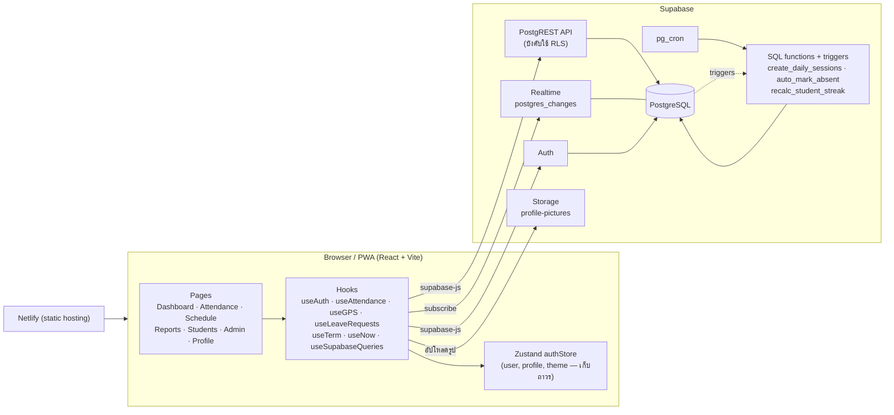

เบราว์เซอร์คุยกับ Supabase โดยตรงด้วย anon key (public) **การตรวจสิทธิ์ทั้งหมดทำที่ Row Level Security ในฐานข้อมูล** ไม่ได้อาศัยฝั่งหน้าเว็บ การป้องกัน route ใน React (`ProtectedRoute`, `AdminRoute`) มีไว้เพื่อประสบการณ์ใช้งานเท่านั้น

แต่ละหน้าแยก chunk และโหลดเมื่อเข้าถึง `@react-pdf/renderer` โหลดตอนกดส่งออก PDF เท่านั้น ถ้า chunk ของหน้าโหลดไม่ได้หลัง deploy จะมีหน้าให้กดลองอีกครั้ง

> [!NOTE]
> `public/sw.js` (cache app shell และ push notification) **ยังไม่ถูก register** ในแอป การทำงานออฟไลน์และ push จึงยังไม่ทำงาน ส่วน manifest ยังใช้ *Add to Home Screen* ได้

---

## บทบาทและสิทธิ์

| ความสามารถ | นักเรียน | ครู | แอดมิน |
|---|:--:|:--:|:--:|
| เช็คชื่อของตัวเอง (GPS / QR) | ได้ | ได้ | ได้ |
| ดูประวัติ streak badge ของตัวเอง | ได้ | ได้ | ได้ |
| ส่งคำขอลาของตัวเอง (พร้อมเหตุผล) | ได้ | — | — |
| ดูการเช็คชื่อของทุกคน | ไม่ได้ | ได้ | ได้ |
| อนุมัติ / ไม่อนุมัติคำขอลา | ไม่ได้ | ได้ | ได้ |
| แก้ไข/เพิ่มสถานะให้คนอื่น | ไม่ได้ | ได้ | ได้ |
| แสดง QR Code ประจำรอบ | ไม่ได้ | ได้ | ได้ |
| จัดการรอบซ้อม วันหยุด ปิดเทอม | ไม่ได้ | ได้ | ได้ |
| หน้ารายชื่อนักเรียน / รายงาน | ไม่ได้ | ได้ | ได้ |
| สร้างบัญชี เปลี่ยน Role ปิดบัญชี | ไม่ได้ | ไม่ได้ | ได้ |
| จัดการภาคเรียน Section GPS (หน้า Admin) | ไม่ได้ | บางส่วน¹ | ได้ |

¹ ครูแก้ไขแถวตั้งค่า GPS ได้ แต่การเพิ่ม/ลบแถวทำได้เฉพาะแอดมิน

Route ของหน้าเว็บ:

| Route | ผู้เข้าถึง |
|---|---|
| `/login`, `/forgot-password`, `/reset-password`, `/qr/:token` | สาธารณะ (หน้า QR จะให้ผู้ใช้เข้าสู่ระบบก่อน) |
| `/dashboard`, `/attendance`, `/schedule`, `/reports`, `/profile` | ผู้ใช้ที่เข้าสู่ระบบแล้ว |
| `/students`, `/admin` | ครูหรือแอดมิน (`AdminRoute`) |

---

## กติกาการเช็คชื่อ

เวลาทั้งหมดเป็น **เวลาประเทศไทย (Asia/Bangkok)** กติกาอยู่ที่เดียวในฝั่งหน้าเว็บ (`ATTENDANCE_RULES` ใน [`src/lib/utils.ts`](src/lib/utils.ts)) และมีฟังก์ชัน SQL ที่ใช้เวลาเดียวกัน `getAttendanceWindowState()` (ก่อนเปิด / เปิด / หมดเวลา) เป็นจุดตรวจเดียวที่แดชบอร์ด หน้าเช็คชื่อ และการบันทึกเช็คชื่อใช้ร่วมกัน หน้าตารางซ้อมสร้างข้อความ "มาปกติถึง / สายถึง" จากกติกาเดียวกัน และ `lateUntil` ต้องตรงกับเวลาของ cron `auto_mark_absent`

| รอบ | วัน | เริ่มรับเช็คชื่อ | มาปกติถึง | สายถึง | ขาดหลัง |
|---|---|---|---|---|---|
| **ซ้อมเช้า** (`morning`) | จ.–ศ. | 05:00 | 07:45 | 08:30 | 08:30 |
| **คาบชุมนุม** (`club`) | พฤ. | 15:20 | 15:45 | 16:00 | 16:00 |
| **ซ้อมพิเศษ** (`extra`) | ตามที่ครูกำหนด | เวลาเริ่มรอบ | — (นับว่า *มา* เสมอ) | — | เวลาสิ้นสุดรอบ |


สถานะที่เป็นไปได้: `present` (มา), `late` (สาย), `absent` (ขาด), `excused` (ลา)

> [!NOTE]
> `present` และ `late` นับว่าเข้าร่วม ส่วน `absent` และ `excused` ทำให้ streak ขาดช่วง

---

## Flow การทำงานของระบบ

### 1. การเข้าสู่ระบบและกู้คืน session

[`src/App.tsx`](src/App.tsx) ดูแลวงจรของการยืนยันตัวตน ออกแบบให้ทนต่ออินเทอร์เน็ตมือถือที่ช้า โดยไม่เด้งผู้ใช้ไปหน้า login โดยไม่จำเป็น

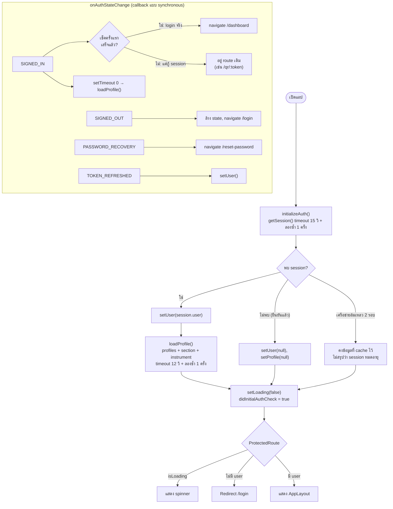

ข้อควรรู้ 2 ข้อ:

- callback ของ `onAuthStateChange` ห้าม `await` คำสั่ง Supabase เพราะ supabase-js ล็อก navigator lock ไว้ระหว่าง callback ทำงาน ถ้า await ข้างในจะ deadlock จึงเลื่อนงานฐานข้อมูลออกไปด้วย `setTimeout(0)`
- `SIGNED_IN` ถูกยิงตอนกู้ session ด้วย แอปจึงเด้งไป `/dashboard` เฉพาะตอน login จริง ไม่เช่นนั้นการสแกน QR จะถูกเด้งออกจาก `/qr/:token`

บัญชีใหม่สร้างด้วย `supabase.auth.signUp` โดย trigger `handle_new_user` ในฐานข้อมูลจะสร้างแถว `profiles` ให้ (Role เริ่มต้นเป็น `student`) จากนั้นฟอร์มของแอดมินจึงอัปเดตข้อมูลโปรไฟล์ที่เหลือ

---

### 2. สร้างรอบซ้อมรายวันอัตโนมัติ

นักเรียนเช็คชื่อกับ **แถวในตาราง `practice_sessions`** ดังนั้นแถวนี้ต้องมีก่อน `pg_cron` จะสร้างรอบของวันถัดไปทุกคืน

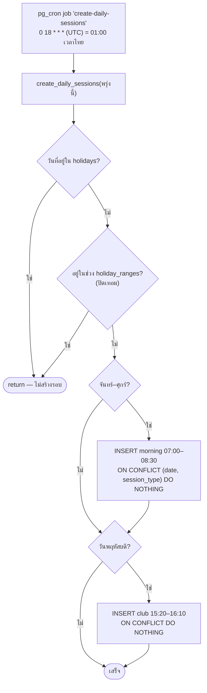

- แต่ละรอบได้ `qr_token` แบบสุ่ม (16 ไบต์ เป็น hex) ตอน insert
- constraint `UNIQUE(date, session_type)` ทำให้รันซ้ำได้อย่างปลอดภัย รวมถึงการสร้างย้อนหลัง
- หน้า `SchedulePage` จะ upsert รอบของพรุ่งนี้ตอนโหลดเป็นตาข่ายสำรอง เผื่อ cron พลาด
- การเพิ่มวันหยุดจะลบรอบของวันนั้นที่ไม่ใช่ override ส่วนรอบที่ครูสร้างเองมี `is_override = true` จะถูกเก็บไว้

---

### 3. เช็คชื่อด้วย GPS (นักเรียน)

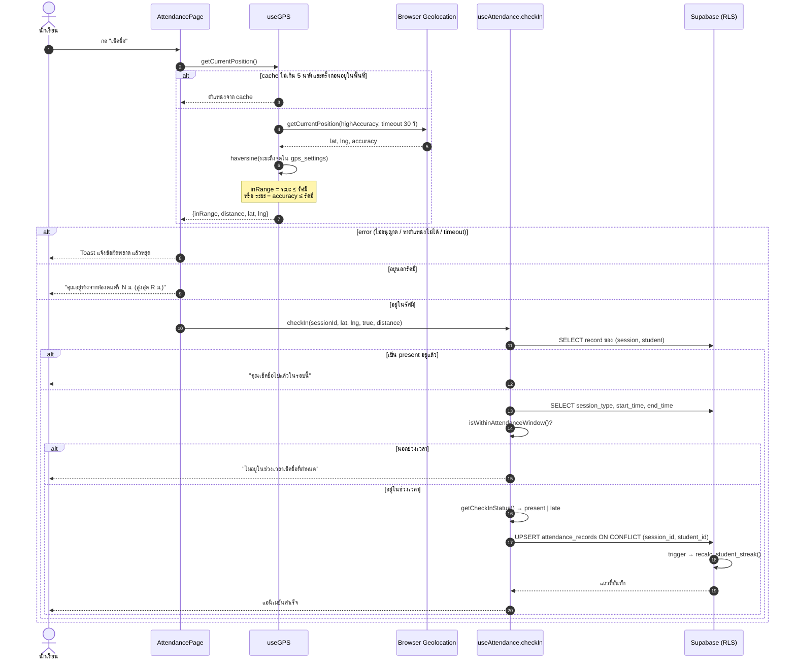

หมายเหตุ:

- มีปุ่มเดียว ใต้ปุ่มแสดงผลระยะห่าง และเตือนเมื่อการเช็คชื่อจะนับเป็นสาย การ์ดเช็คชื่อด่วนในแดชบอร์ดใช้ขั้นตอนเดียวกัน
- ใช้ตำแหน่งจาก cache ซ้ำเฉพาะถ้าครั้งก่อนอยู่ในพื้นที่ นักเรียนที่เดินเข้าพื้นที่แล้วกดใหม่จึงได้ตำแหน่งใหม่
- พิกัดและรัศมีมาจากตาราง `gps_settings` (แอดมินแก้ไขได้) ถ้าโหลดไม่ได้จะใช้ค่าเริ่มต้นที่ฝังในโค้ด
- การนับ accuracy เข้ามาช่วยไม่ให้ปฏิเสธนักเรียนที่ยืนอยู่ขอบรัศมีขณะที่ GPS คลาดเคลื่อน
- ช่วงเวลาและสถานะคำนวณจาก **นาฬิกาของเครื่องผู้ใช้ที่แปลงเป็นเวลาไทย** ส่วน policy ในฐานข้อมูลตรวจเพียงว่า `student_id = auth.uid()` ไม่ได้ตรวจเวลาซ้ำ ดังนั้นให้มองว่า GPS/QR ป้องกันการใช้งานผิดพลาดทั่วไป ไม่ใช่ระบบกันการปลอมแปลงเต็มรูปแบบ

---

### 4. เช็คชื่อด้วย QR Code (นักเรียน)

ครูกดปุ่ม **เปิด QR เช็คชื่อ** ที่การ์ดของรอบนั้นในหน้า `/attendance` หน้าจอเต็ม (`QRPresenter`) แสดง QR ขนาดใหญ่ของ `https://<host>/qr/<qr_token>` ตัวนับ "มาแล้ว / ที่ต้องมา" แบบสด รายชื่อ 5 คนล่าสุด และคำเตือนถ้ารอบยังไม่เปิดหรือหมดเวลา ครูสลับเป็นเต็มจอเบราว์เซอร์เพื่อฉายขึ้นจอได้ นักเรียนสแกนด้วยกล้องมือถือ แล้วหน้าเว็บจะเปิดขึ้น

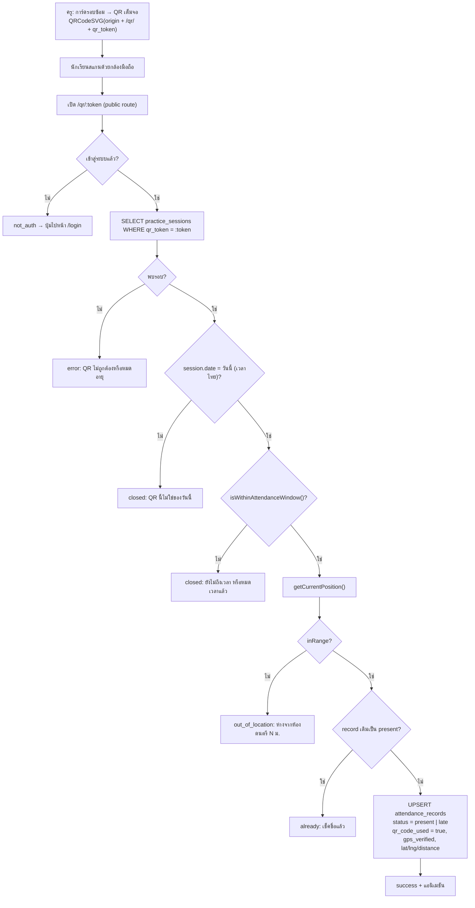

QR token พิสูจน์ว่านักเรียนถือโค้ดที่ครูแสดงอยู่จริง ส่วน GPS พิสูจน์ว่าอยู่ใกล้ห้องซ้อมจริง ต้องผ่านทั้งสองอย่าง ถ้ายังไม่ได้เข้าสู่ระบบ หน้าจะแสดงปุ่มไป login และหลัง login แอปไม่บังคับเด้งไปหน้าอื่น จึงกลับมาทำรายการที่ `/qr/:token` ต่อได้

---

### 5. คำขอลา (ครูอนุมัติ)

นักเรียนตั้งสถานะตัวเองเป็น "ลา" ไม่ได้ ต้องส่งคำขอพร้อมเหตุผล แล้วแจ้งครูให้กดอนุมัติในระบบ

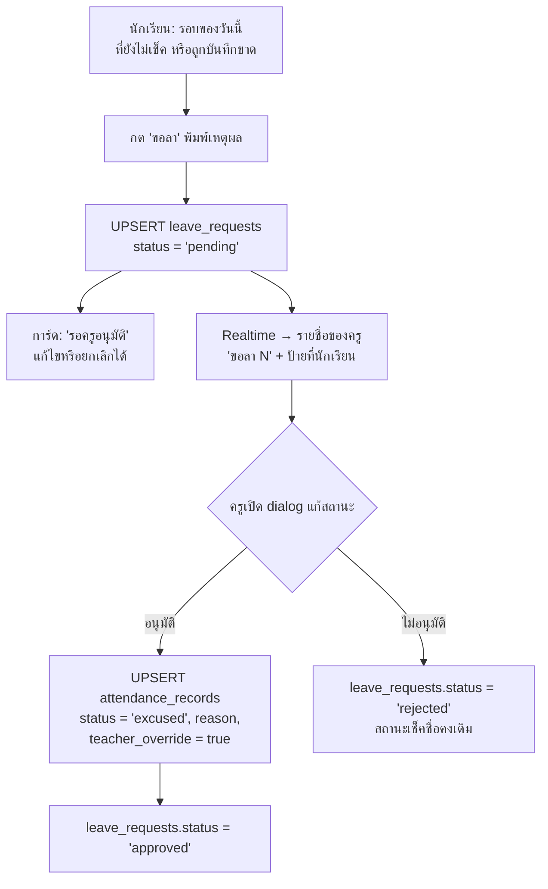

RLS (migration `024`) ให้นักเรียนเพิ่ม แก้ และลบได้เฉพาะคำขอของตัวเองที่ยัง **รออนุมัติ** การอนุมัติหรือไม่อนุมัติทำได้เฉพาะครูและแอดมิน record สถานะ *ลา* ที่อนุมัติแล้วจะไม่ถูกงานบันทึกขาดอัตโนมัติเขียนทับ เพราะงานนั้นเพิ่มแถวเฉพาะนักเรียนที่ยังไม่มี record

---

### 6. ระบบบันทึกขาดอัตโนมัติ

นักเรียนที่ไม่เช็คชื่อต้องมีแถว `absent` เพื่อให้รายงานและ streak ถูกต้อง ระบบทำงาน **2 ที่** เพื่อความทนทาน

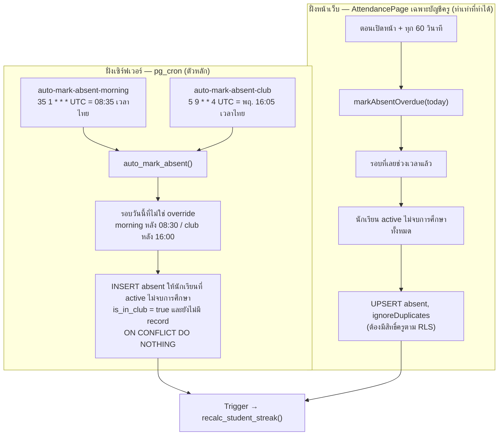

- งาน cron เป็นแหล่งข้อมูลหลัก ส่วนการกวาดฝั่งหน้าเว็บช่วยให้ครูเห็นข้อมูลล่าสุดทันทีหลังหมดเวลา และรันเฉพาะบัญชีครู เพราะ RLS ให้นักเรียนอ่านได้แค่แถวของตัวเอง
- งาน SQL จะข้ามนักเรียนที่ `is_in_club = false` (ดู [ข้อยกเว้น ร.ด.](#9-ข้อยกเว้น-รด-บ่ายวันพฤหัส))

---

### 7. ครูแก้ไขสถานะ (Override)

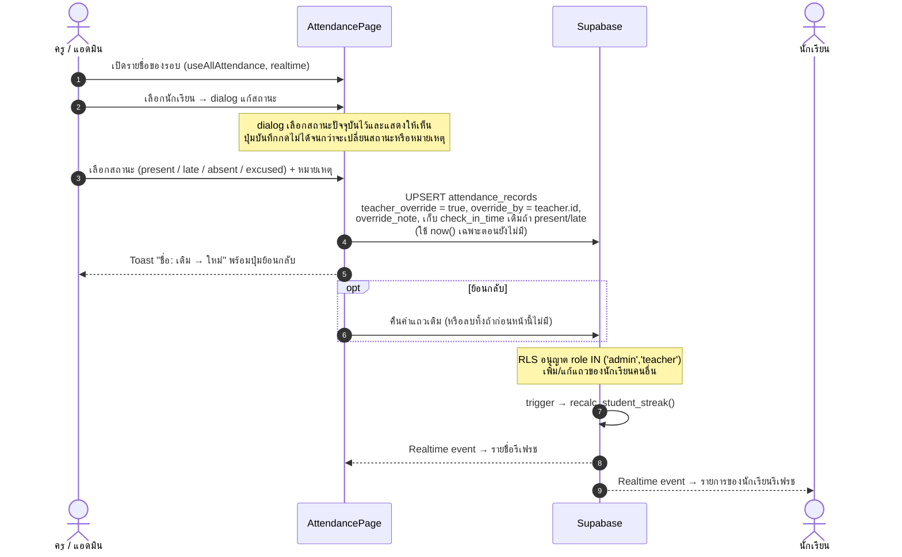

แถวที่ถูก override จะเก็บ `teacher_override`, `override_by` และ `override_note` เพื่อให้ตรวจสอบย้อนหลังได้ ถ้านักเรียนมีคำขอลารออนุมัติ dialog เดียวกันจะแสดงคำขอพร้อมปุ่มอนุมัติ / ไม่อนุมัติ

---

### 8. Streak และ Badge

คำนวณในฐานข้อมูลทั้งหมด เพื่อให้ทุกช่องทางการบันทึก (GPS, QR, override, cron) ให้ผลตรงกัน

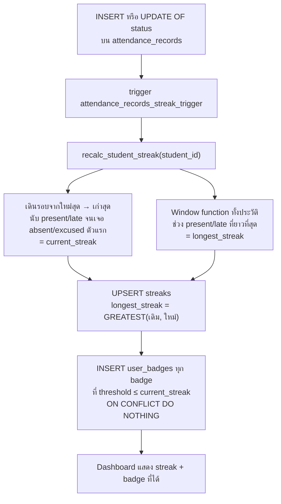

- streak นับจาก **รอบซ้อมที่มีจริง** ตามลำดับ เสาร์-อาทิตย์และวันหยุดที่ไม่มีรอบจึงถูกข้ามอัตโนมัติ
- badge เริ่มต้น: `streak_3`, `streak_5`, `streak_10`, `streak_20` ตาราง `badges` เป็นแคตตาล็อก เพิ่มแถวใหม่ได้โดยไม่ต้อง deploy
- เมื่อลบรอบซ้อม `streaks.last_session_id` จะถูกตั้งเป็น `NULL` แทนที่จะบล็อกการลบ (migration `023`)

---

### 9. ข้อยกเว้น ร.ด. บ่ายวันพฤหัส

นักเรียนที่ `is_in_club = false` ไปเรียน ร.ด. ตอนบ่ายวันพฤหัสแทนคาบชุมนุม รอบนั้นจึงต้องไม่นับเป็นการขาด

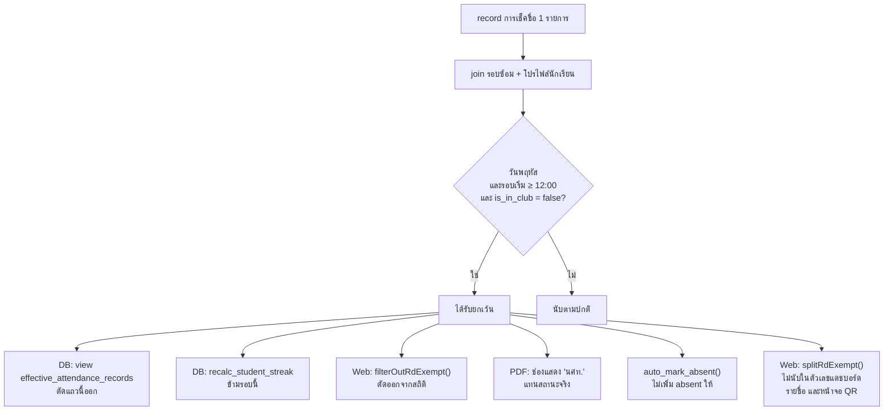

กติกานี้อยู่ใน [`src/lib/attendanceExemption.ts`](src/lib/attendanceExemption.ts) และสะท้อนใน migration `022` ถ้าอนาคตมี `session_type` เฉพาะสำหรับรอบนี้ ให้ใส่ใน `THURSDAY_AFTERNOON_SESSION_TYPES` (ฝั่งเว็บ) และแก้เงื่อนไข `WHERE` ของ view (ฝั่ง SQL) เพื่อเปลี่ยนจากการเดาด้วยเวลามาใช้ชนิดรอบแทน

---

### 10. ตารางซ้อม วันหยุด และรอบพิเศษ

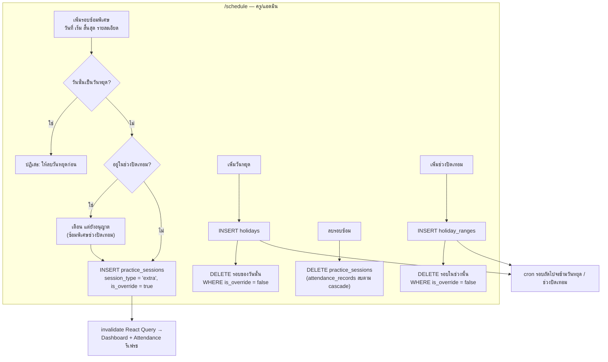

รอบพิเศษไม่มีกติกาเวลาตายตัว: เช็คชื่อได้ระหว่าง `start_time` ถึง `end_time` ที่บันทึกไว้ และการเช็คชื่อสำเร็จนับเป็น `present` เสมอ

---

### 11. จัดการภาคเรียนและเลื่อนชั้น

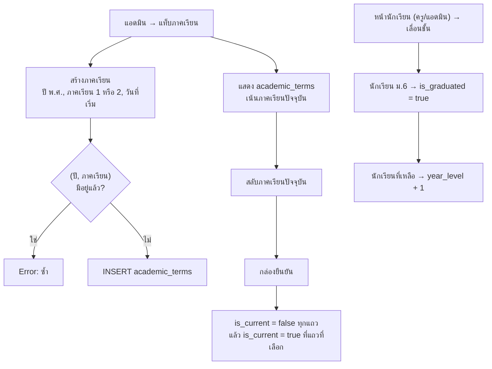

---

### 12. รายงานและส่งออก PDF

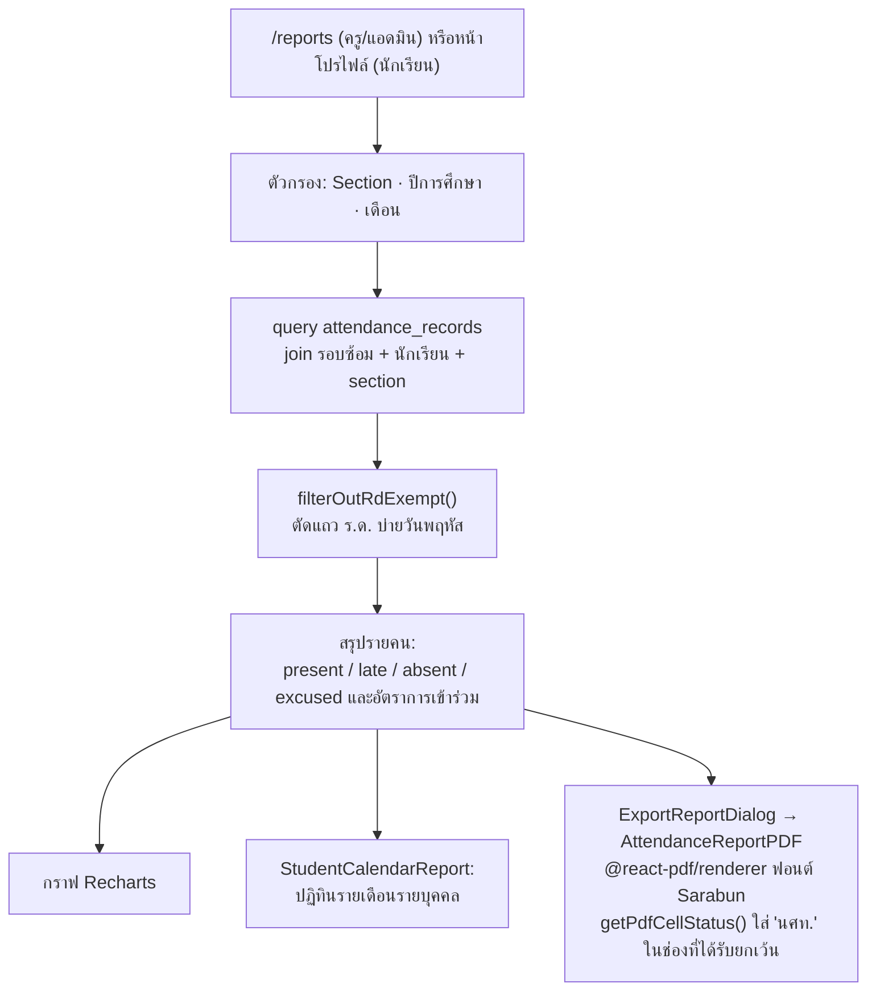

ฟอนต์ Sarabun อยู่ใน `public/fonts/` เพื่อให้ PDF แสดงภาษาไทยได้โดยไม่ต้องโหลดจากภายนอก หัวตารางพิมพ์ซ้ำทุกหน้า และคำอธิบายสัญลักษณ์อยู่ท้ายทุกหน้า

---

## โครงสร้างฐานข้อมูล

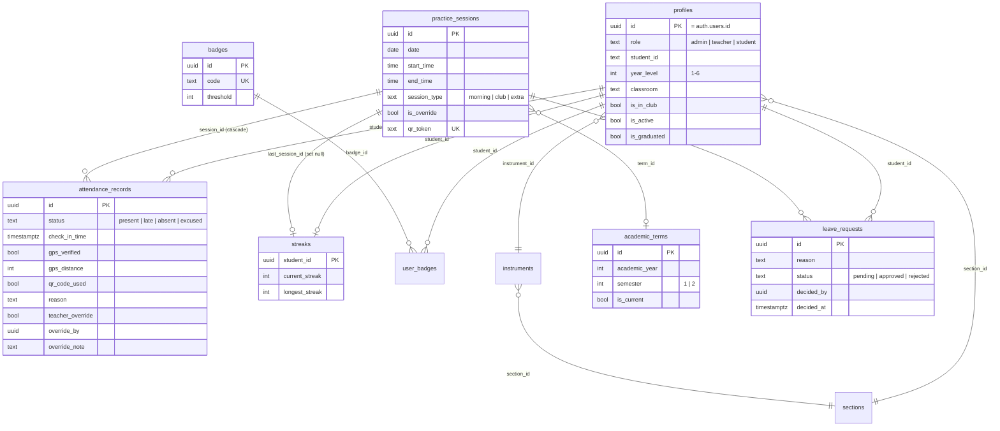

ตารางอื่น: `holidays`, `holiday_ranges`, `gps_settings`, `schedule_overrides`, `notifications` / Storage bucket: `profile-pictures` (อ่านได้สาธารณะ เขียนได้เมื่อเข้าสู่ระบบ) / View: `effective_attendance_records`

Constraint สำคัญ: `UNIQUE(date, session_type)` ของรอบซ้อม และ `UNIQUE(session_id, student_id)` ของการเช็คชื่อและคำขอลา ทำให้ทุกการเขียนเป็น upsert ที่รันซ้ำได้

### Migrations

รันไฟล์ใน [`supabase/migrations/`](supabase/migrations/) **ตามลำดับตัวเลข**:

| ไฟล์ | หน้าที่ |
|---|---|
| `001_initial` | Schema หลัก, RLS, storage bucket, ข้อมูลเริ่มต้น section/เครื่องดนตรี, ภาคเรียน |
| `002_hotfix_trigger` | แก้ trigger สร้างผู้ใช้ใหม่ |
| `003_fix_rls_recursion` | แก้ RLS วนซ้ำ (เพิ่ม `get_my_role()`) |
| `004_holidays`, `005_holiday_ranges` | ตารางวันหยุดและช่วงปิดเทอม |
| `006_gps_settings`, `007_fix_gps_settings_policies` | ตั้งค่า GPS ได้ + แก้ policy |
| `008_add_classroom` | เพิ่ม `profiles.classroom` |
| `009_attendance_rls_policies` | policy การเช็คชื่อของนักเรียน/ครู |
| `010_create_daily_sessions_fn` | ฟังก์ชัน `create_daily_sessions()` |
| `011_schedule_daily_sessions_cron` | cron รายคืน + สร้างย้อนหลังครั้งแรก |
| `012_daily_sessions_end_0810`, `013_daily_sessions_clean_descriptions` | ปรับเวลาสิ้นสุด / คำอธิบายรอบ |
| `014_teacher_insert_attendance_policy` | ครูเพิ่มการเช็คชื่อให้คนอื่นได้ |
| `015_fix_cron_date_cast` | แก้การ cast วันที่ใน cron |
| `016_backfill_sessions_jun_jul` | สร้างรอบย้อนหลัง (ครั้งเดียว) |
| `017_set_morning_end_0830`, `018_daily_sessions_end_0830` | ตั้งเวลาสิ้นสุดซ้อมเช้าเป็น 08:30 (แถวเดิม + ฟังก์ชัน) |
| `019_add_indexes` | index เพิ่มประสิทธิภาพ |
| `020_auto_mark_absent` | `auto_mark_absent()` + cron 2 งาน |
| `021_streaks_badges` | ตาราง streak/badge ฟังก์ชัน trigger RLS |
| `022_thursday_rd_exemption` | view `effective_attendance_records` + ปรับ streak |
| `023_fix_streak_session_fk` | `ON DELETE SET NULL` ให้ `streaks.last_session_id` |
| `024_leave_requests` | ตาราง `leave_requests`, RLS, realtime (จำเป็นตั้งแต่ v1.1.0) |

> [!IMPORTANT]
> หลายไฟล์นิยามฟังก์ชัน `create_daily_sessions()` ซ้ำ ไฟล์เลขสูงกว่าจะทับไฟล์ก่อนหน้า จึงควรรันครบทั้งชุด ไม่เลือกรันบางไฟล์

---

## โครงสร้างไฟล์

```
src/
├── App.tsx                         # Routes, วงจร auth, route guards
├── main.tsx
├── components/
│   ├── admin/                      # SemesterManager, GPSSettingsManager
│   ├── attendance/QRPresenter.tsx  # QR เต็มจอพร้อมตัวนับสด
│   ├── layout/AppLayout.tsx        # Layout หลัก เมนู สลับธีม
│   ├── reports/                    # StudentCalendarReport, ExportReportDialog, AttendanceReportPDF
│   ├── CheckInSuccessAnimation.tsx
│   └── ui/                         # shadcn/ui components
├── hooks/
│   ├── useAuth.ts                  # เข้า/ออกจากระบบ รหัสผ่าน
│   ├── useAttendance.ts            # checkIn, qrCheckIn, markAbsentOverdue, รายชื่อ realtime
│   ├── useLeaveRequests.ts         # คำขอลา: ส่ง ยกเลิก อนุมัติ / ไม่อนุมัติ
│   ├── useNow.ts                   # re-render ทุก 30 วินาทีสำหรับ UI ที่ขึ้นกับเวลา
│   ├── useGPS.ts                   # Geolocation, haversine, cache 5 นาที (เฉพาะตอนอยู่ในพื้นที่)
│   ├── useGPSSettings.ts           # อ่าน gps_settings
│   ├── useTerm.ts                  # ภาคเรียน
│   └── useSupabaseQueries.ts       # React Query hooks (รอบ, streak, badge, รายงาน)
├── lib/
│   ├── supabase.ts                 # Supabase client
│   ├── utils.ts                    # ATTENDANCE_RULES, getAttendanceWindowState, getErrorMessage, เวลาไทย
│   └── attendanceExemption.ts      # กติกายกเว้น ร.ด. บ่ายวันพฤหัส, splitRdExempt
├── pages/                          # Dashboard, Attendance, QRCheckIn, Schedule, Reports,
│                                   # Students, Admin, Profile, Login, Forgot/ResetPassword
├── store/authStore.ts              # Zustand (user, profile, theme) เก็บถาวร
└── types/index.ts
public/                             # PWA manifest, service worker (ยังไม่ register), ไอคอน, ฟอนต์ไทย
supabase/migrations/                # SQL รันตามลำดับตัวเลข
```

---

## คู่มือการติดตั้ง

### 1. สร้างโปรเจค Supabase
1. สมัครที่ [supabase.com](https://supabase.com) แล้วกด **New project**
2. ตั้งชื่อและรหัสผ่านฐานข้อมูล แล้วรอประมาณ 2 นาที

### 2. เปิดใช้ Extension
ไปที่ **Database → Extensions** แล้วเปิด **`pg_cron`** (จำเป็นสำหรับสร้างรอบรายคืนและบันทึกขาดอัตโนมัติ)

### 3. รัน Migration
เปิด **SQL Editor** แล้วรันทุกไฟล์ใน `supabase/migrations/` **ตามลำดับตัวเลข** (`001` → `024`)

### 4. ตั้งค่า Authentication
1. **Authentication → Providers → Email**: ปิด "Confirm email" หากแอดมินเป็นคนสร้างบัญชีและไม่ต้องการยืนยันอีเมล
2. **Authentication → URL Configuration**: เพิ่ม `http://localhost:5173` (และ URL จริงของเว็บ) ใน **Redirect URLs** เพื่อให้ลิงก์รีเซ็ตรหัสผ่านใช้งานได้

### 5. สร้างแอดมินคนแรก
สร้างผู้ใช้ 1 คน (Authentication → Users → Add user) แล้วเลื่อนเป็นแอดมินใน SQL Editor:

```sql
update public.profiles set role = 'admin' where email = 'you@example.com';
```

บัญชีถัดไปสร้างจากในแอปได้ (**Admin → บัญชี**)

### 6. ตั้งค่าพิกัด GPS
เข้าสู่ระบบด้วยแอดมิน → **Admin → GPS** แล้วกำหนด latitude, longitude และรัศมีที่อนุญาต (เมตร) ของห้องดนตรี

### 7. รันในเครื่อง
```bash
cp .env.example .env
# แก้ .env ด้วยค่าจาก Supabase → Settings → API
#   VITE_SUPABASE_URL=https://xxxx.supabase.co
#   VITE_SUPABASE_ANON_KEY=your-anon-key

npm install
npm run dev        # http://localhost:5173
```

สคริปต์อื่น: `npm run build` (ตรวจ type + build), `npm run preview` ส่วน `npm run lint` ตอนนี้ยังรันไม่ได้ เพราะ ESLint 9 ต้องมี `eslint.config.js` ซึ่งโปรเจกต์ยังไม่มี

> [!WARNING]
> ใส่เฉพาะ **anon** key ในฝั่งหน้าเว็บ ห้ามใส่ `service_role` key ใน `.env`

---

## Deploy

ใช้ Netlify ตั้งค่าไว้ใน [`netlify.toml`](netlify.toml) (build `npm run build`, publish `dist`, redirect ทุก path ไป `/index.html` สำหรับ SPA)

```bash
npm install -g netlify-cli
netlify login
netlify init
netlify deploy --prod
```

หรือเชื่อม Git repository ใน Netlify Dashboard แล้วตั้ง Environment variables `VITE_SUPABASE_URL` และ `VITE_SUPABASE_ANON_KEY` อย่าลืมเพิ่ม URL ของ Netlify ใน Supabase **Redirect URLs**

---

## License

ดู [LICENSE](LICENSE)
